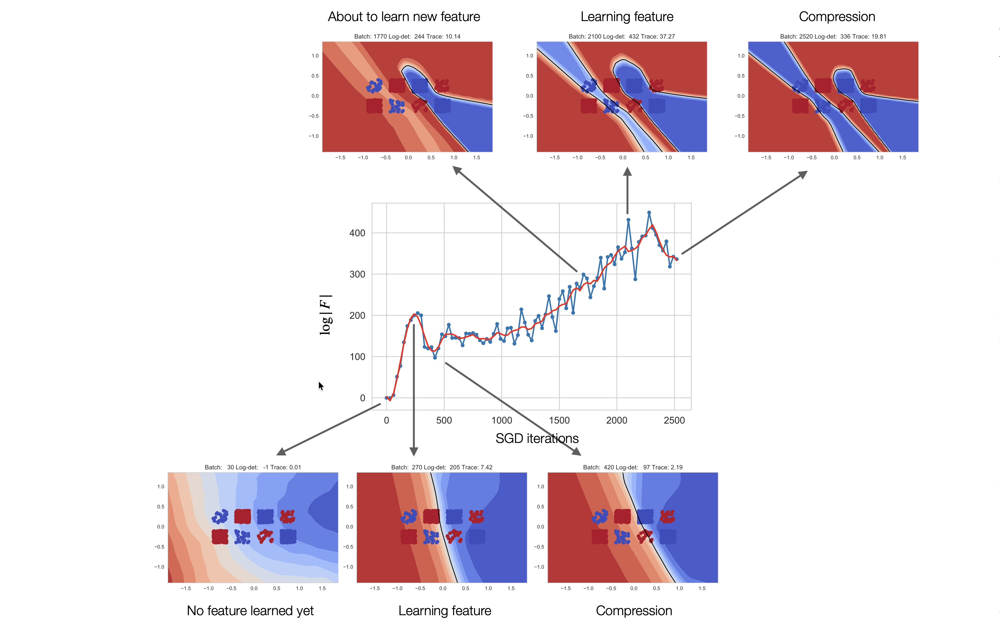

## 1. Introduction

Central question of the paper is 

> After a neural network has been trained, how much information about the training data is actually stored in its weights, and how can we measure it?

The paper proposes a framework for answering this, and then connects that quantity to generalization, Fisher information, SGD, and invariance

## 2. Information in the weights

We could measure the information in the weights by looking at their coding leghth after training but not all of the weigths are equally important. We could apply small perturbations to weights $(w' = w + \delta w )$ to see how much the loss changes. If the loss does not change much, then we can say that the weights are not important and we can compress them. If the loss changes a lot, then we can say that the weights are important and we would need to store them with higher precision.
In other words, we measure information in a weight by how its perturbation affects the loss.  

---

#### Definition (Information in the weights). 
 
Define P, pretrained distribution of weights, as $P(w) = N(0,\lambda^2I)$ 

and Q, the distribution of weights after training as $Q(w|D)= N(w^*,\Sigma)$.

$$\\
{
C_\beta(D;P,Q)
=
\mathbb E_{w\sim Q(w|D)}
[L_D(p_w(y|x))]
+
\beta
D_{\mathrm{KL}}(Q(w|D)\|P(w))
}\\
$$

where $E_{w\sim Q(w|D)}[L_D(p_w(y|x))]$ is the loss under the distribution $Q(w|D)$

and $D_{\mathrm{KL}}(Q(w|D)\|P(w))$ measures the entropy of Q(w|D) relative to P(w) 

 

If $Q^*(w|D)$ minimizes the equation for a given $\beta$, we call $D_{\mathrm{KL}}(Q(w|D)\|P(w))$the amount of Information in the Weights for the task $D$ at level $\beta$.

---

They claim that their definition of complexity function is compatible with:

- deterministic training $\rightarrow$ one learned $w^*$, with a chosen $Q$ around it;

- stochastic training $\rightarrow$ potentially a distribution of learned weights;

- Bayesian NN $\rightarrow$ an actual Bayesian posterior can be used as $Q$.

For $\beta=1$, the mathematical form coincides with the KL part of the Bayesian evidence lower-bound.

---

They interpret $KL(Q|P)$ as the information/coding cost of the weights because it is the expected excess description length required to encode weights distributed according to $Q$ using a coding scheme based on $P$.

 
In their framework, what matters is not the particular value of the coding length, but how it changes as a function of $\beta$

---

### 2.1 Information in the weights and generalization

**Theorem** (McAllester (2013), Theorems 2-4). *Assume the dataset $D= {(x_i,y_i)}^N_{i=1}$ is sampled i.i.d. from a distribution $p(y,x)$, and assume that the per-sample loss used for training is bounded by $L_{max} = 1$. For any fixed $\beta >1/2$, $\delta >0$, $P(w)$, and weight distribution $Q(w|D)$, with probability at least $1 - \delta$ over the sample of D, we have:*

$$ 
L_{test}(Q) \leq \frac{1}{1-\frac{1}{2\beta}} \left( E_{w\sim Q}[L_D(p_w)] + \frac{\beta}{N} ( KL(Q||P) + \log \frac{1}{\delta} ) \right) 
$$

*where $L_{test}(Q) := E_{x,y\sim p(x,y)}[E_{w\sim Q}[−log p_w(y|x)]]$ is the expected per-sample test error that the model incurs using the weight distribution $Q(w|D)$. Moreover, given a distribution $p(D)$ over datasets, we have the following bound in expectation*
$$
E_D[L_{test}(Q)] \leq \frac{1}{1-\frac{1}{2\beta}} \left( E_D[E_{w\sim Q}[L_D(p_w)]] + \frac{\beta}{N}  E_D[ KL(Q||P)] \right)
$$

Hence, minimizing the complexity $C_{\beta} (D; P,Q)$ can be interpreted as minimizing an upper-bound on the test error, rather than merely minimizing the training error.

---

### 2.2 Information in the weights and Fisher information

Their definition of complexity depends on arbitrary pre- and post-training distributions. However, different choices of $P$ and $Q$ can be related to Shannon and Fisher information.

In some cases, there may be a true prior $\pi (D)$ over training sets. Then, a natural choice of pre-distribution $P(w)$ is the one that minimizes the expected test error bound in the equation, which they call the *adapted prior*

---

**Proposition** (Shannon IW). Assume the dataset $D$ is sampled from a distribution $\pi (D)$, and let the outcome of training on a sampled dataset $D$ be described by a distribution $Q(w|D)$. Then the pre-distribution $P(w)$ minimizing the expected complexity $E_D[C_β(D; P,Q)]$ is the marginal
$P(w) = E_D[Q(w|D)]$, and the expected Information in the Weights is given by
$$ E_D[KL( Q \| P)] = I(w; D) $$

which is Shannon’s mutual information between the weights and the dataset. Here, the weights are seen as a (stochastic) function of the dataset, given by the training algorithm.

---

The pre-distribution $P(w)$ is optimal given the choice of the training algorithm (i.e., the map $A: D\rightarrow Q(w|D)$) and the distribution of training datasets $\pi (D)$. With this choice, we have the following expression for the expectation over $D$ of the complexity function:

$$ E_D[C_\beta (D; P,Q)] = E_D[E_{w\sim Q}[L_D(w)]] + \beta I(w; D)
$$

This expression is the general form of an Information Bottleneck. Unlike that IB, the Information Lagrangian (IL) of the equation concerns the weights, which are the bottleneck between the training dataset $D$ and inference on the future test distribution. Hence, the IL directly relates to the training process and the finite nature of the dataset.

 

While the adapted prior of the proposition allows computing an optimal generalization bound, it requires averaging with respect to all possible datasets, which in turn requires knowledge of the distribution $\pi (D)$ and is, in general, unrealistic.

---

At the other extreme, we can consider an uninformative pre-distribution.

**Lemma** (The Fisher is a semi-definite approximation
of the Hessian, Martens (2014, eq. 6 and Sect. 9.2)). The Hessian $H= \nabla^2_w L_D(w)$ of the loss function can be decomposed as
$$
H= F+ \frac{1}{N} \sum_{(x,y)\in D} \sum_{j=1}^k \left[\nabla_zL(y,z)|_{z=f_w} (x)\right]_j H_{[f]_j}
$$

where F is the Fisher Information matrix, $z = f_w(x)$ is the output of the network for the input $x$, $L(y,z) = - \sum_{j=1}^k \delta_{y,j} \log(z_j)$ is the cross-entropy loss for the input $x$, and $H_{[f]_j}$ is the Hessian of the j-th component of $z$. Then, if almost all training samples are predicted correctly, as we expect in a well-trained network, we have $\nabla_z L(y,z) \approx 0$ and $H \approx F$ to first-order approximation.

---

Their definition reduces to the Fisher Information when one chooses the arbitrary pre-distribution and post-distribution to be Gaussian.

Let $P(w) \sim N(0,\lambda^2 I)$ and $Q(w|D)\sim N(w^*,Σ)$, centered at any local minimizer $w^*$ of the cross-entropy loss obtained with any optimization algorithm. For a sufficiently small $\beta$, the covariance $\Sigma$ that minimizes $C_\beta (D; P,Q)$ is
$$
\Sigma^* = \frac{\beta}{2} (H+ \frac{\beta}{2\lambda^2}I)^{-1}
$$

For $\Sigma = \Sigma^*$, the *Information in the Weights* becomes,

$$
KL(Q||P) = \frac{1}{2} \log |H + \frac{\beta}{2\lambda^2}| + \frac{1}{2} k \log \frac{2\lambda^2}{\beta} - k + \frac{1}{2\lambda^2} [||w^*||^2 + tr[\frac{\beta}{2}+(H + \frac{\beta}{2\lambda^2})^{-1}]]
$$

If most training samples are predicted correctly, we can estimate inofrmation by substituting $H \approx F$.

---

---

### 2.3 Information in the Learning Dynamics

In this section they argue that, for a deep network trained with stochastic optimization on a given domain, Fisher and Shannon are equivalent up to second-order. Informally, the argument goes as follows: (i) The Fisher depends on the domain of the data, but not on the labels, hence all tasks sharing the same domain share the same Fisher, (ii) SGD implicitly minimizes the Fisher and, hence, (iii) tends to concentrate solutions in regions of low Fisher, thus indirectly minimizing the Shannon Information given the geometry and topology of the residual loss.

 

While (i) follows from the definition, (ii) is not immediate, as SGD does not explicitly minimize the Fisher. The result hinges on the stochasticity of SGD, that tends to preferentially escape sharp minima and, since the Fisher measures the curvature of the loss, tends to evade solutions with high Fisher.

---

**Proposition (Berglund, 2011, Eq. 1.9).**

Let $w^*$ be a local minimizer of the loss function $L_D(w^*)$. Consider the path $\gamma$ joining $w^*$ with any other minimum with the least increase in loss. The point with the highest loss along the path is a saddle point $w_s$ with a single negative eigenvalue $\lambda_1(w_s)$.

Then, in the limit of small step size $\eta$, the expected time for a stochastic gradient-based algorithm with isotropic noise to escape the minimum is given by*

$$
\mathbb{E}[\tau]
=
\frac{2\pi}{|\lambda_1(w_s)|}
e^{\frac{1}{T}\left(\Phi(w_s)-\Phi(w^*)\right)},
$$

where the free energy is $\Phi(w)=L_D(w)+\frac{T}{2}\log|\mathbf{F}(w)|$ and $T\propto\eta/B$, where $B$ is the batch size. In particular, increasing the temperature parameter T makes the stochastic optimization more likely to avoid minima with high Fisher Information.

---

What matters to our thesis is not the numerical value of the escape time, but the tendency of the optimization to converge to flatter vs. sharper minima as the temperature increases. 

 

Both the empirical evidence and the analysis indicate that the optimization, rather than minimizing directly the loss function, minimizes a free energy $\Phi(w) = L_D(w)+ \frac{T}{2} \log|F(w)|$, which is connected with the Fisher Information in the Weights.

---

We can now finally address (iii), connecting Fisher and Shannon in DNNs

 

**Proposition (Stochastic Optimization Links Shannon and Fisher Information).**

Assume the space of datasets $D$ admits a differentiable parametrization. Assume that $p(D|w)$ is concentrated around a single dataset (i.e., the one used for training), and choose as post-distribution $p(w|D) \sim N\left(w^*, \beta \mathbf{F}(w^*)^{-1}\right)$, where $w^* = w^*(D)$ are the mean weights obtained at the end of training on a dataset $D$. Then we have the approximation, up to second order,

$$
I(w;D)
\approx
H(D)
-
\mathbb{E}_D
\left[
\frac{1}{2}
\log
\left(
\frac{\beta(2\pi e)^k}
{\left|\nabla_D w^{*T}\mathbf{F}(w^*)\nabla_D w^*\right|}
\right)
\right],
$$

where $H(D)$ is the entropy of $D$, and we assume that $\nabla_D \mathbf{F}(w^*) \ll \nabla_D w^*.$ The term $\nabla_D w^*$ is the Jacobian of the final point with respect to changes in the training set.

---

The authors introduce hypothetical Gaussian noise around the trained weights to make Shannon mutual information $I(w;D)$ measurable.

They then establish a connection between three quantities:

- **Fisher Information:** Measures the sensitivity of the network's predictions to changes in its weights. Lower Fisher Information corresponds to flatter minima.
- **SGD stability:** Measured by $\|\nabla_D w^*\|$, which describes how sensitive the final weights are to changes in the training dataset.
- **Shannon mutual information:** Measures how much information the trained weights contain about the training dataset.

**Main conclusion:** Under their assumptions, reducing Fisher Information or increasing SGD stability can reduce $I(w;D)$, leading to better generalization guarantees through the PAC-Bayes bound.

However, flatness or stability alone is not sufficient to explain generalization; they must be considered in context.

---

## 3. The Role of Information in the Invariance of the Representation

After a successful training, the weigts of the NN are sufficient (small training loss), and minimal (small information). Sufficiency of the weigts impies sufficiency of the activations. We also need them to be minimal. However, DNNs trained for classification retain enough information on the original image to allow one to reconstruct it from the last layer activations. This is well beyond what is needed to classify, which is just the label, the activations cannot be minimal. The main contribution of the paper is to show the connection between the minmality of the weigths and the invariance of the activations.

First, they introduce the notion of effective information in the activations: Rather than measuring the information that a hypothetical decoder could extract, they measure the information that the trained network effectively uses to perform the task. They then show that the Fisher Information in the Weights bounds the effective Fisher and Shannon information in the activations. 

---

### 3.1. Induced Stochasticity and Effective Information in the Activations

By definition if inofrmation of a particular feature is small or unstable, meaning that perturbations of the weights do not affect the loss, then the feature should not be used by the network to perform the task. So they define the effective information in the activations as the information that is actually used by the network to perform the task.

**Definition** (Effective Information in the Activations) Let $w$ be a weight and $n \sim N (0, \Sigma_w^*)$, with $\Sigma_w^* = \beta F^{-1}(w)$ a perturbation minimizing Eq. (2) at level $\beta$ for an uninformative prior. We call effective information (at level $\beta$) the amount of information about $x$ that is retained after the (hypothetical) perturbation:

$$
I_{eff,\beta}(x; z) = I(x; z_n),
$$

where $z_n = f_{w+n}(x)$ are the activations computed by the perturbed weights $w+n \sim N(w, \Sigma_w^*)$.

---

Using this definition we obtatian the following charachterization of information in the activations.

**Proposition**. For small values of $\beta$, we have that (i) The Fisher $F_{z|x} = \mathbb{E}_z[\nabla_x^2 \log p(z|x)]$ of the activations given the input is:
$$
F_{z|x} = \frac{1}{\beta}\nabla_x f_w \cdot J_f F_w J_f^t \nabla_x f_w,
$$

where $\nabla_x f_w(x)$ is the Jacobian of the representation with respect to the input, and $J_f(x)$ is the Jacobian with respect to the weights. In particular, the Fisher of the activations goes to zero when the Fisher of the weights $F_w$ goes to zero. (ii) If, for any representation $z$, the distribution $p(x|z)$ of inputs that could generate it concentrates around its maximum, we have:

$$
I_{eff,\beta}(x;z)
\approx
H(x) - \mathbb{E}_x\left[
\frac{1}{2}\log\left(\frac{(2\pi e)^k}{|F_z|_x|}\right)
\right].
$$

Hence, by (i), when the Fisher of the weights decreases, the effective mutual information between inputs and activations also decreases.

---

Reducing the Fisher Information in the weights, reduces the effective mutual information between inputs and activations at test time. Similarly, making $\nabla_x f_w(x)$ small makes its activations less sensitive to changes in the input, further reducing this information.

Since a representation is maximally invariant to nuisances when it minimizes the information retained about the input while preserving task-relevant information, the authors conclude that minimizing information in the weights encourages the network to learn invariant representations naturally during training.

Importantly, information about nuisances may still exist in the weights, but it is not accessible through the network's effective representation.

---

## 4. Empirical Validation

**Relation between curvature, Fisher and Shannon Information.**

In this section the authors investigate the relationship between Fisher and Shannon Information using a simple model trained with SGD. They found that increasing SGD’s temperature, for example by reducing the batch size, leads the optimization to favor flatter regions of the loss landscape with lower Fisher Information, which also reduces Shannon Information in the weights. This supports their theoretical prediction that minimizing Fisher Information through stochastic optimization can indirectly reduce Shannon Information.

The authors used a toy regression model to investigate the relationship between Fisher and Shannon Information. The model uses a redundant parameterization, allowing multiple parameter values to produce the same prediction while corresponding to minima with different curvatures. This mimics the complex loss landscapes of deep neural networks and allows the authors to investigate how SGD's temperature affects the information stored in the weights. They find that increasing SGD's temperature by reducing the batch size encourages convergence to flatter minima with lower Fisher Information, which also reduces Shannon Information. In contrast, full-batch gradient descent retains the most information in the weights.

---

![**Relation between curvature, Fisher and Shannon Information.** (**Left**) Plot of the marginal distribution of the parameter $w$ at the end of training, marginalized over all possible training tasks $D$, as the batch size $B$ of SGD changes. As the batch size gets smaller, SGD shifts farther away from areas with high Fisher Information (dotted line), supporting Proposition 2.8. (**Center**) Effect of the batch size on the Information in the Weights. Remarkably, while changing the batch size should only affect the Fisher Information, it also reduces the Shannon Information of the weights following the same qualitative dependence, in support of Proposition 2.9. (**Right**) Redundant parametrization $\phi(\theta)$ used in the experiment to emulate some of the key properties of the loss landscape of deep networks.](iw2.jpeg)

---

**Stability, Fisher and Information.**

The authors investigate the relationship between SGD stability, loss landscape curvature, and the information stored in neural network weights. They pre-train an All-CNN network on MNIST digits 2–9, then train it to classify digits 0 and 1. To measure stability, they repeat the training after replacing one sample in the dataset while keeping the initialization, random seed, and hyperparameters unchanged. The difference between the final weights of the two runs approximates how sensitive the learned solution is to changes in the training data. They also visualize the loss landscape's curvature using the inverse Fisher Information Matrix, represented as an ellipse whose larger axes indicate lower curvature. The experiment illustrates Proposition 2.9: **when the final weights are relatively stable to dataset perturbations and the loss landscape has low curvature, the network tends to retain less Shannon Information about the training data**, which is associated with better generalization.

---

![**Stability, Fisher and Information**. For a convolutional network, plot of the training path of two datasets (red and green lines) that differ by one single example, projected onto a plane. We used SGD as the training algorithm, with the same random seed and initialization for the two datasets. In blue are shown the level curves of the loss function. The amount of Shannon Information that SGD stores in the weights depends on the distance between the final points when training on a perturbed dataset (stability), and the Fisher Information Matrix (whose inverse is shown by the blue ellipse) measures the local curvature. In this case, the distance between the final points is small relative to the curvature, suggesting that SGD is not memorizing (overfitting) that sample.](iw3.jpeg)

---

**Fisher Information and dynamics of feature learning.**

They now look whether changes in the Fisher Information correspond to the network learning features of increasing complexity. They built a 3-layer network for a classification of 2D points, and they plot the Fisher and the classification boundaries during training. As features are learned, there are corresponding "bumps" on the Fisher Information Matrix. Learning a feature can be seen as crossing a narrow bottleneck (high curvature, and high Fisher) in the loss landscape, followed by a compression phase as the network moves away toward flatter area of the loss landscape. These *phase transitions*, where the network suddenly learns a feature after a relatively stable period, are also oberved when analyzing activations, which supports the proposition 3.2.

---

---

**Fisher Information for CIFAR-10.**

Finally, the authors extend their experiments to a more realistic setting by training a ResNet-18 on CIFAR-10. First, they investigate how SGD's batch size affects Fisher Information, finding that smaller batches lead to lower Fisher Information after 30 epochs, consistent with their theoretical predictions. Second, they examine how task complexity affects the information stored in the weights by training on different numbers of CIFAR-10 classes. They expect simpler tasks, such as classifying only two classes instead of ten, to require less information in the weights and therefore exhibit lower Fisher Information.

---

![**Fisher Information in CIFAR-10**. (**Left**) Trace of the Fisher Information in the weights of a ResNet-18, after 30 epochs of training on CIFAR-10, for different values of the batch size. A smaller batch size yields a smaller Fisher Information, supporting Proposition 2.8. (**Right**) Fisher Information at the end of the training on a subset of CIFAR-10 with only the first kclasses: After training on fewer classes, the network has less Information in the Weights, suggesting that the Information in the Weight has a semantic role.](iw4.jpeg)

---
